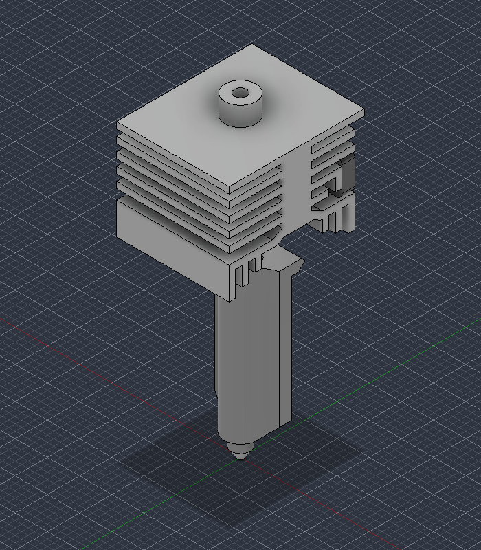
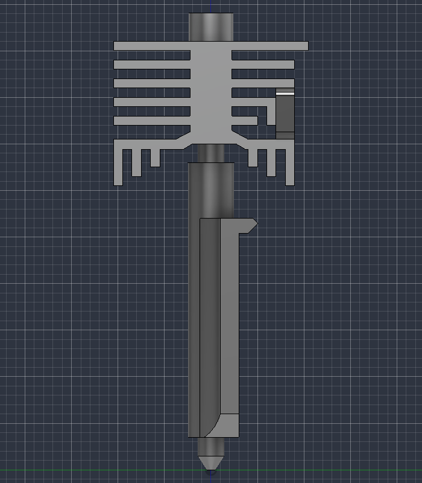
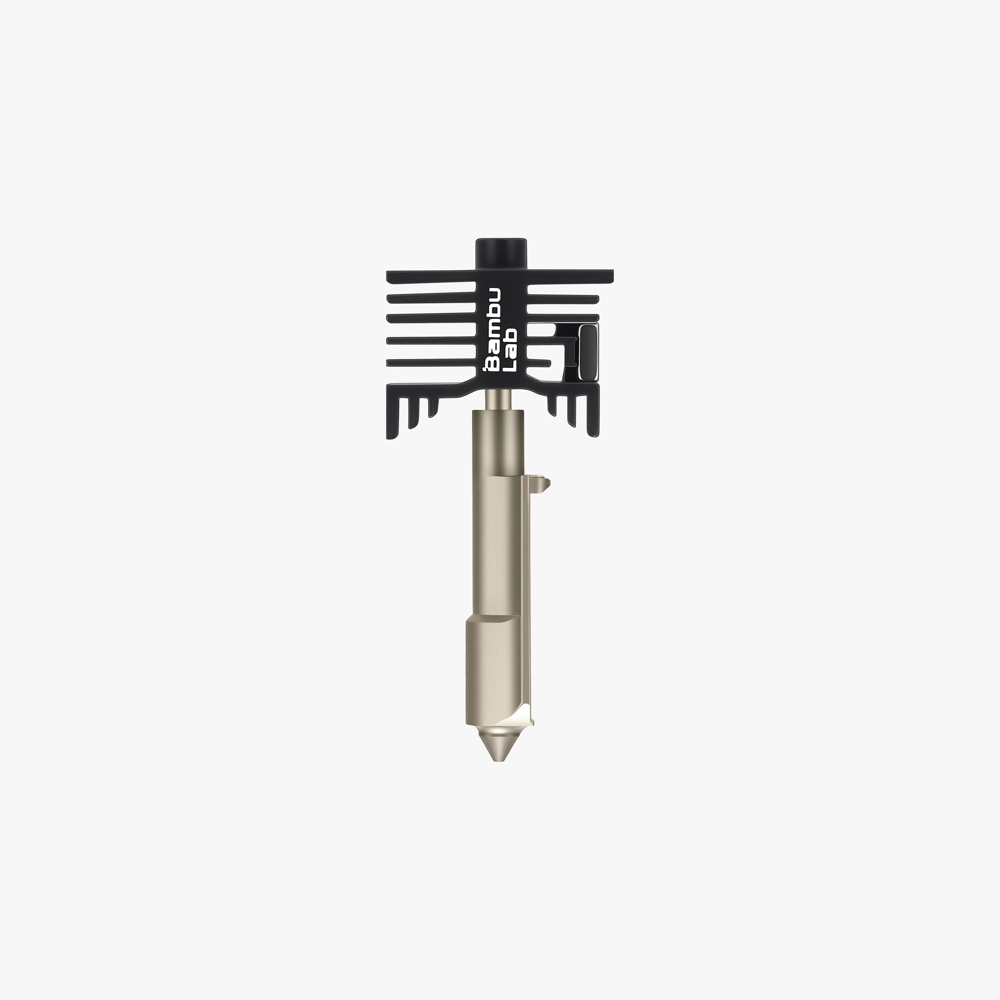
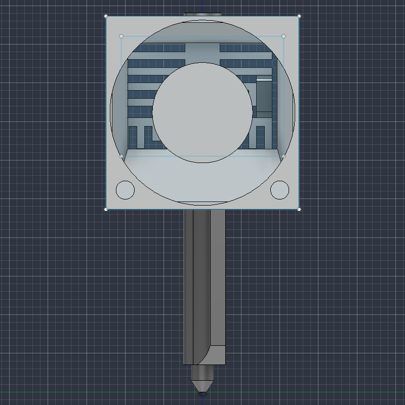
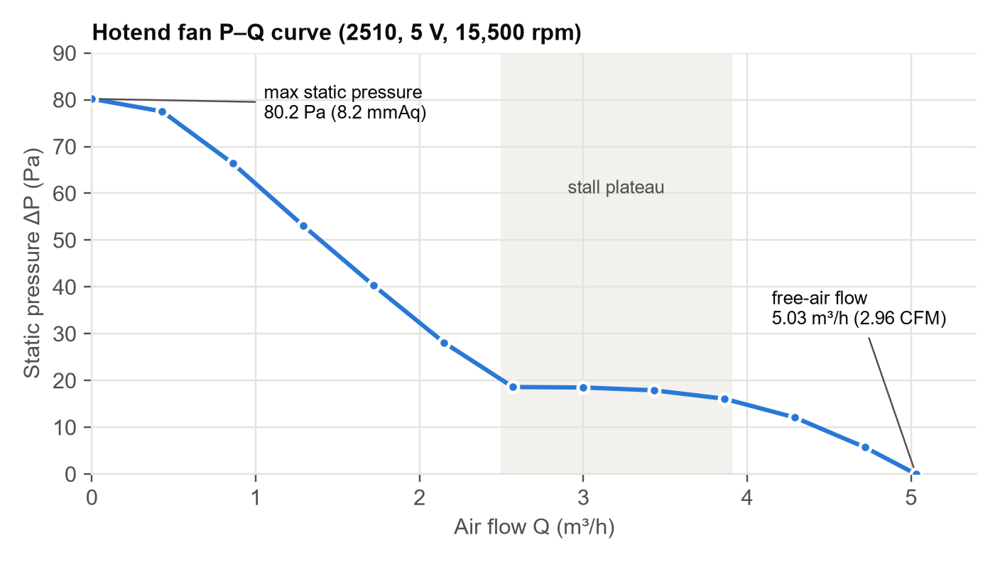
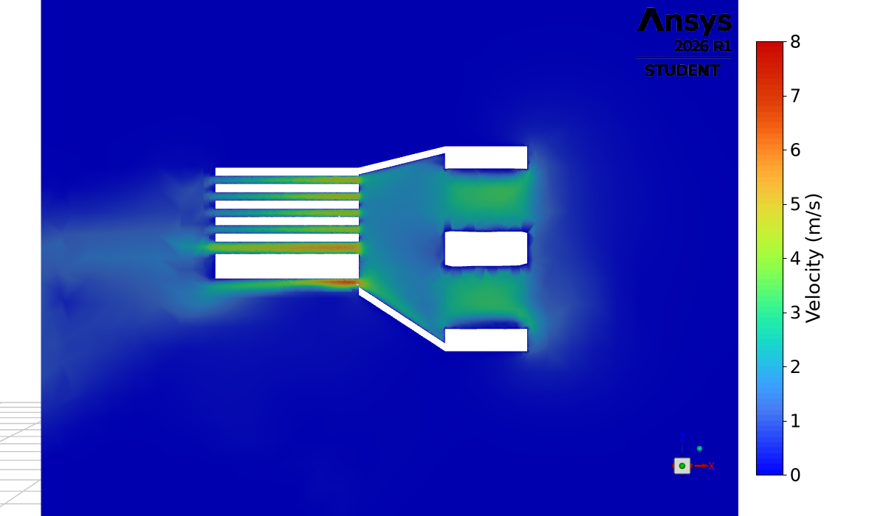
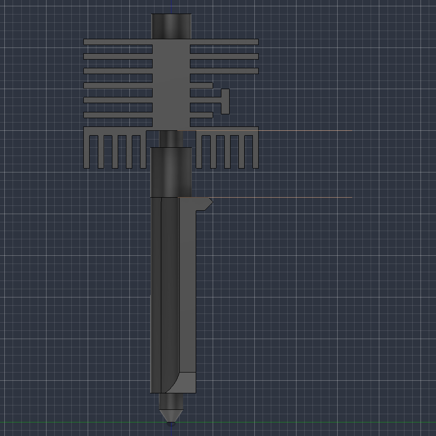
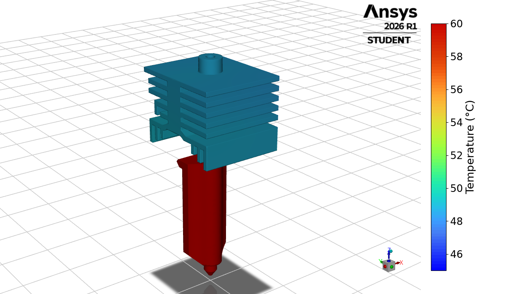
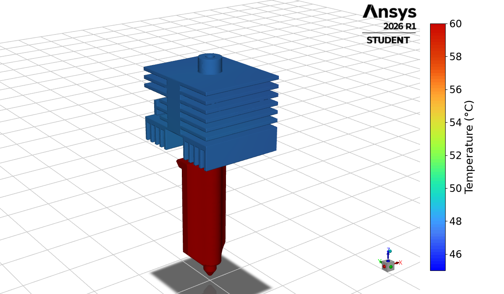

# 3D Printer Hotend Cooling Simulation (CFD)

CAD and conjugate-heat-transfer CFD of the Bambu Lab X2D / P2S hotend cooled by a 2510 fan through its duct, with two redesigned heatsinks. Course project 2103306, Chulalongkorn University.


## Results (45 °C ambient, nozzle body 220 °C, Pelonis C2510X05 fan curve)

| Case | Heat-break inlet (°C) | Heatsink max (°C) |
|---|---|---|
| Stock | 57.69 | 57.75 |
| Design 1 | 50.81 | 50.02 |
| Design 2 | 49.96 | 49.21 |

Design 2 mesh study (278k / 441k / 783k cells): oscillatory convergence, uncertainty about ±0.8 °C, so Design 2 is a borderline pass of the ≤ 50 °C heatsink criterion. Full write-up: `Hotend_Cooling_Report.pdf` (Thai).

## Layout

- `x2d_hotend_clean.py`, `x2d_hotend_fan_assembly.py` – Fusion 360 API scripts: clean parametric hotend, fan and duct assembly (`*.step`, `*.f3d` exports).
- `X2D_Nozzle_*` – source STL of the hotend (original 300 % and scaled 1:1).
- `fan_curve_2510.csv` – fan pressure–flow curve.
- `cfd/` – CFD domain scripts (`cfd_geometry_*.py`), Fluent Watertight meshing (`mesh_wtm.py`), case setup and solve via PyFluent (`setup_case.py`, `run_case.py`, `step*.py`), mesh study (`meshstudy.ps1`, `gci.py`), results in `cfd/results/`.
- `diagram/` – labelled component diagram.

Fluent mesh, case and data files (`*.h5`) are not included; rebuild them with `cfd/mesh_wtm.py` and `cfd/setup_case.py` (Ansys Fluent 2026 R1 + `ansys-fluent-core`).

---

# Full report (Thai)

Converted from [`Hotend_Cooling_Report.docx`](Hotend_Cooling_Report.docx); figures are in [`report/media`](report/media).


**การออกแบบและวิเคราะห์ระบบระบายความร้อนของฮอตเอนด์เครื่องพิมพ์สามมิติ**

**(3D Printer Hotend Cooling Analysis)**

เสนอ

รศ.ดร.นิพนธ์ วรรณโสภาคย์

อ.ดร.เสฎฐวรรธ สุจริตภวัตสกุล

จัดทำโดย

ณัฏฐภัทร นิลสุวรรณ 6730154821

รายงานนี้เป็นส่วนหนึ่งของรายวิชาคอมพิวเตอร์ช่วยการออกแบบทางวิศวกรรมเครื่องกล 2103306

ภาคการศึกษาต้น ปีการศึกษา 2569

จุฬาลงกรณ์มหาวิทยาลัย

## Part 1: Title, Objective and Design Criteria

### บทนำ

โปรเจคนี้จัดทำขึ้นเพื่อศึกษาการออกแบบ การจำลอง และพัฒนา **ระบบระบายความร้อนของฮอตเอนด์ (Hotend)** ของเครื่องพิมพ์สามมิติแบบ FDM โดยใช้ฮอตเอนด์ของเครื่อง Bambu Lab ตระกูล H2/P2S/X2D เป็นกรณีศึกษา ใช้โปรแกรม Autodesk Fusion 360 สำหรับการสร้างแบบจำลองสามมิติ และใช้ซอฟต์แวร์ ANSYS Fluent ในการวิเคราะห์การถ่ายเทความร้อนร่วมกับการไหลของอากาศ **(Conjugate Heat Transfer, CHT)**

ฮอตเอนด์ทำหน้าที่หลอมเส้นพลาสติกและฉีดออกทางหัวฉีด ประกอบด้วย **หัวฉีด (Nozzle)** ที่ถูกให้ความร้อนถึงประมาณ 190–300 °C, **ฮีตเบรก (Heat Break)** ซึ่งเป็นท่อที่ลดการนำความร้อน, **ฮีตซิงก์อะลูมิเนียมแบบครีบ (Heatsink)** และพัดลมระบายความร้อน หน้าที่ของฮีตซิงก์คือรักษาส่วนบนของฮอตเอนด์ให้เย็น เพื่อให้เส้นพลาสติกหลอมเฉพาะบริเวณหัวฉีดเท่านั้น

หากความร้อนไหลย้อนขึ้นไปด้านบน **(Heat Creep)** เส้นพลาสติกจะอ่อนตัวก่อนถึงหัวฉีด ขยายตัว และติดผนังท่อ ทำให้เกิดการอุดตัน (Clog) โดยเฉพาะ PLA ซึ่งมีอุณหภูมิเปลี่ยนสถานะคล้ายแก้ว (Glass Transition Temperature) ประมาณ 55–60 °C ดังนั้นประสิทธิภาพของฮีตซิงก์และพัดลมจึงมีผลโดยตรงต่อความน่าเชื่อถือของการพิมพ์

ระบบที่ศึกษาประกอบด้วยส่วนประกอบสำคัญที่ถอดแบบมาจากเครื่องพิมพ์ Bambulab ได้แก่ **ฮอตเอนด์ (หัวฉีดและฮีตเบรก)**, **ฮีตซิงก์พร้อมแผ่นล็อก (Latch)**, **พัดลมขนาด 2510** (25 × 25 × 10 mm, 5 V, 15,500 rpm, อัตราการไหลสูงสุด 2.96 CFM) และ **ท่อนำลม (Duct)** ที่บังคับให้อากาศไหลผ่านช่องระหว่างครีบของฮีตซิงก์

### วัตถุประสงค์

โปรเจคนี้มีวัตถุประสงค์หลักเพื่อ **วิเคราะห์การกระจายอุณหภูมิ** ในฮอตเอนด์และฮีตซิงก์แบบเดิมภายใต้สภาวะการใช้งานจริง โดยตรวจสอบ **อุณหภูมิที่ทางเข้าฮีตเบรก** เทียบกับเกณฑ์การออกแบบ, วิเคราะห์ **การไหลของอากาศและความดันตก (Pressure Drop)** ผ่านช่องครีบและท่อนำลม, ตลอดจนนำผลการวิเคราะห์ไปพัฒนาการออกแบบฮีตซิงก์ ท่อนำลม หรือพัดลม เพื่อ **ลดอุณหภูมิของส่วนเย็น (Cold End)** โดยยังคงขนาดติดตั้งและจุดยึดเดิมของหัวพิมพ์

### เกณฑ์การออกแบบ (Design Criteria)

- อุณหภูมิหัวฉีด (Nozzle Temperature) ที่ใช้ในการวิเคราะห์คือ **220 °C** (การพิมพ์ PLA)

- อุณหภูมิที่ทางเข้าฮีตเบรก (บริเวณซ็อกเก็ตของฮีตซิงก์) ต้อง **ไม่เกิน 50 °C** ซึ่งต่ำกว่า Glass Transition Temperature ของ PLA

- อุณหภูมิอากาศแวดล้อม (Ambient Temperature) คือ **45 °C**

- อุณหภูมิสูงสุดของฮีตซิงก์ต้องไม่เกิน 50 °C

- ฮีตซิงก์ที่ออกแบบใหม่ต้องมีอุณหภูมิทางเข้าฮีตเบรกและอุณหภูมิสูงสุดของฮีตซิงก์ ต่ำกว่าหรือใกล้เคียงกับแบบเดิม

- ฮีตซิงก์ที่พัฒนาต้องติดตั้งได้ในพื้นที่เดิม **17.5 × 21 × 18.5 mm** และใช้พัดลมขนาด 2510 เดิม

## Part 2: Preparation

### 1) นิยามและทฤษฎีที่เกี่ยวข้อง

#### 1.1) การนำความร้อน (Conduction) – กฎของฟูริเยร์

``` math
q\  = \  - k\ \frac{dT}{dx}\ \ \ \ \ ,\ \ \ \ \ Q\  = \ \frac{kA\ \Delta T}{L}
```

- q = ฟลักซ์ความร้อน (W/m²), Q = อัตราการถ่ายเทความร้อน (W)

- k = สัมประสิทธิ์การนำความร้อนของวัสดุ (W/m·K), A = พื้นที่หน้าตัด (m²), L = ความยาวเส้นทางความร้อน (m)

#### 1.2) การพาความร้อน (Convection) – กฎการเย็นตัวของนิวตัน

``` math
Q\  = \ h\ A\ (T_{s}\  - \ T_{\infty})
```

- h = สัมประสิทธิ์การพาความร้อน (W/m²·K), Tₛ = อุณหภูมิผิว, T∞ = อุณหภูมิอากาศ

#### 1.3) ครีบระบายความร้อน (Extended Surfaces)

``` math
m\  = \ \sqrt{\frac{hP}{kA_{c}}}\ \ \ \ \ ,\ \ \ \ \ \eta_{f}\  = \ \frac{tanh(mL_{c})}{mL_{c}}
```

``` math
Q_{fin}\  = \ \eta_{f}\ h\ A_{f}\ (T_{b}\  - \ T_{\infty})
```

- $`P`$ = เส้นรอบรูปของครีบ, $`A_{c}`$ = พื้นที่หน้าตัดครีบ, $`L_{c\ }`$= ความยาวครีบที่ปรับแก้ (corrected length)

- $`\eta_{f}`$= ประสิทธิภาพครีบ (Fin Efficiency), $`A_{f}`$= พื้นที่ผิวครีบ, $`T_{b}`$ = อุณหภูมิที่โคนครีบ

#### 1.4) ความต้านทานความร้อน (Thermal Resistance)

``` math
R_{cond}\  = \ \frac{L}{kA}\ \ \ \ \ ,\ \ \ \ \ R_{conv}\  = \ \frac{1}{hA}\ \ \ \ \ ,\ \ \ \ \ T_{hb}\  - \ T_{\infty}\  = \ Q\ \sum R
```

- ใช้ประเมินเส้นทางความร้อนจากหัวฉีด → ฮีตเบรก → ฮีตซิงก์ → อากาศ อย่างคร่าว ๆ ก่อนการจำลอง CFD

#### 1.5) สมการพื้นฐานของการวิเคราะห์ CFD (Conjugate Heat Transfer)

- สมการความต่อเนื่อง (Continuity):

``` math
\nabla \cdot (\rho u)\  = \ 0
```

- สมการโมเมนตัม (Navier–Stokes):

``` math
\nabla \cdot (\rho uu)\  = \  - \nabla p\  + \ \nabla \cdot \tau\  + \ \rho g
```

- สมการพลังงานในของไหลและในของแข็ง:

``` math
\nabla \cdot (\rho c_{p}uT)\  = \ \nabla \cdot (k\nabla T)\ \ \ \ \ ,\ \ \ \ \ \nabla \cdot (k_{s}\nabla T)\  + \ S\  = \ 0
```

- เงื่อนไขที่ผิวสัมผัสของแข็ง–ของไหล: อุณหภูมิและฟลักซ์ความร้อนต่อเนื่องกัน
  ``` math
  T_{f} = T_{s}\quad\quad\text{and}\quad\quad k_{f}\,\frac{\partial T_{f}}{\partial n} = k_{s}\,\frac{\partial T_{s}}{\partial n}
  ```

#### 1.6) จุดทำงานของพัดลมและลักษณะการไหล

``` math
\Delta P\  = \ K\ \dot{V}^{2}\ \ \ \ \ ,\ \ \ \ \ Re\  = \ \frac{\rho\ V\ D_{h}}{\mu}\ \ \ \ \ ,\ \ \ \ \ D_{h}\  = \ \frac{4A_{c}}{P}
```

- จุดทำงานจริงของพัดลมคือจุดตัดระหว่างกราฟพัดลม (Fan Curve) กับกราฟความต้านทานของระบบ (System Curve) ดังนั้นอัตราการไหลจริงจะต่ำกว่า 2.96 CFM ที่ระบุสำหรับการไหลอิสระ

- ช่องระหว่างครีบกว้างประมาณ 1 mm ทำให้ Dₕ ≈ 2 mm ผลจาก CFD พบว่าความเร็วลมในช่องครีบประมาณ 5–7 m/s และความหนืดจลน์ของอากาศที่ 45 °C ประมาณ 1.75 × 10⁻⁵ m²/s จะได้ Re ≈ 570–800 ซึ่งเป็นการไหลแบบราบเรียบ (Laminar) ภายในช่องครีบ แต่บริเวณอื่นมีลำลมจากพัดลมและการผสมของอากาศ จึงเลือกแบบจำลอง k-ω SST ซึ่งใช้ได้ทั้งการไหลใกล้ผนังและการไหลแบบปั่นป่วน และตรวจสอบผลกระทบด้วยการคำนวณแบบ Laminar เปรียบเทียบ (Part 3 หัวข้อ 5.3)

### 2) การเตรียมแบบจำลองสามมิติ (3D Modeling)

#### 2.1) ข้อมูลการโมเดลโดยรวม

- ไฟล์ที่ใช้: x2d_hotend_fan_assembly.step (ชุดประกอบพร้อมพัดลมและท่อลม) และ x2d_hotend_clean.step (เฉพาะฮอตเอนด์)

- หน่วยที่ใช้: ระบบหน่วย Metric (mm, kg, N, s, °C)

- ขนาดคร่าว ๆ (Bounding Box): ประมาณ 38 mm × 25 mm × 49 mm (X × Y × Z) โดยจุดกำเนิดอยู่ที่ปลายหัวฉีด แกน Z ชี้ขึ้น และพัดลมอยู่ด้าน +X เป่าลมในทิศ −X

- ส่วนประกอบและน้ำหนักโดยประมาณ (คำนวณจากปริมาตรของแบบจำลอง)

**ตารางที่ 1 ส่วนประกอบและน้ำหนักโดยประมาณ**

| **ส่วน**                 |     **วัสดุ**     | **ปริมาตร (mm³)** | **น้ำหนัก (g)** |
|-------------------------|:---------------:|:----------------:|:-------------:|
| ฮอตเอนด์ (หัวฉีด + ฮีตเบรก) | Stainless Steel |     1,082.0      |     ≈ 8.7     |
| ฮีตซิงก์                   |  Aluminum 6061  |     2,757.4      |     ≈ 7.4     |
| แผ่นล็อก (Latch)          |      Steel      |      194.2       |     ≈ 1.5     |
| พัดลม 2510 (โครง + ดุม)   |       ABS       |     2,962.9      |    ≈ 3.1\*    |
| ท่อนำลม (Duct)           |       ABS       |      746.0       |     ≈ 0.8     |

**\* แบบจำลองพัดลมไม่รวมมอเตอร์และใบพัด**

#### 2.2) การสร้างแบบจำลอง 3 มิติ (3D Part)

เนื่องจากผู้ผลิตไม่ได้เผยแพร่ไฟล์ CAD ของฮอตเอนด์ จึงใช้ไฟล์ STL ของฮอตเอนด์ X2D ที่เผยแพร่ มาทำการวัดขนาและสร้างแบบจำลองแบบพาราเมตริกใหม่ในโปรแกรม Autodesk Fusion 360 ได้ผิวเรียบไม่เป็นเหลี่ยมตาข่าย โดยปริมาตรต่างจากไฟล์ STL ไม่เกิน 1.2% ส่วนพัดลมและท่อลมสร้างจากข้อมูลจำเพาะของพัดลมและการวัดจากหัวพิมพ์จริง

#### 2.2.1) องค์ประกอบที่สำคัญในการสร้างแบบจำลอง

1.  **ฮอตเอนด์ (Hot End):** ลำตัวหน้าตัดรูปตัว D (แกนกลาง Ø5 mm และปีกกว้าง 10 mm) มุมลบ 45° ที่ปลายล่าง คอ Ø5 mm และแกนสวม Ø2.92 mm ที่สวมเข้าซ็อกเก็ตของฮีตซิงก์ ปลายหัวฉีดมีรู Ø0.38 mm

2.  **ฮีตซิงก์ (Cold End / Heatsink):** อะลูมิเนียม ขนาด 17.5 × 21 × 18.5 mm มีผนังกลางหนา 4.5 mm ครีบแนวนอนหนา 1 mm ระยะห่าง 2 mm ครีบตั้งด้านล่าง 6 ครีบ และบอสด้านบน Ø4.8 mm โดยช่องครีบเปิดตามแนวแกน X ให้ลมจากพัดลมไหลผ่าน

3.  **แผ่นล็อก (Latch):** แผ่นเหล็กขนาด 17.5 × 5.5 × 2 mm สวมในร่องด้าน +Y ของฮีตซิงก์

4.  **พัดลม (Fan 2510):** ขนาด 25 × 25 × 10 mm ช่องลม Ø24 mm ดุมกลาง Ø13 mm (5 V, 15,500 rpm, 2.96 CFM)

5.  **ท่อนำลม (Duct):** ผนังหนา 0.8 mm เปลี่ยนหน้าตัดจาก 25 × 25 mm ที่พัดลม เป็น 21 × 15.5 mm ที่ด้านข้างฮีตซิงก์


*รูปที่ 1 แผนภาพส่วนประกอบของฮอตเอนด์ (a) มุมมองด้านหน้าพร้อมทิศทางการไหลของอากาศ (b) มุมมองด้านข้างของฮอตเอนด์*

#### 2.2.2) การลดความซับซ้อนของแบบจำลอง (Simplification)

เพื่อลดเวลาและทรัพยากรในการคำนวณใน ANSYS Fluent จึงมีการปรับลดรายละเอียดของแบบจำลองบางส่วน ดังนี้

- ไม่จำลองรูทางเดินเส้นพลาสติก (Filament Bore) เนื่องจากไฟล์ STL ต้นฉบับเป็นแบบจำลองเพื่อการแสดง

- ไม่จำลองชุดฮีตเตอร์ (Heating Assembly) แต่กำหนดอุณหภูมิคงที่ 220 °C ให้ลำตัวหัวฉีดทั้งก้อน (z = 0–27 mm) แทน

- ไม่จำลองใบพัดของพัดลม แต่ใช้เงื่อนไขขอบเขตแบบพัดลม (Fan Boundary Condition) ที่หน้าตัดช่องลม

- ตัดสกรู สายไฟ เปลือกหัวพิมพ์ และตะแกรงช่องลมออก

- ในแบบจำลอง CFD ตัดรูปลายหัวฉีด Ø0.38 mm แผ่นล็อก และรูสลักออก ปิดช่องว่าง 0.01 mm ระหว่างแกนสวมกับซ็อกเก็ต และใช้ช่องลมพัดลม Ø23 mm เพื่อให้สร้าง Mesh ได้



*รูปที่ 2 ภาพแบบจำลองฮอตเอนด์จากโปรแกรม Fusion 360*

<table>
<colgroup>
<col style="width: 50%" />
<col style="width: 50%" />
</colgroup>
<thead>
<tr>
<th style="text-align: center;"><p></p>
<p>รูปที่ 3 ภาพด้านข้างของแบบจำลอง</p></th>
<th style="text-align: center;"><p></p>
<p>รูปที่ 4 ภาพด้านข้างของฮอตเอนด์จริง (Bambu Lab)</p></th>
</tr>
</thead>
<tbody>
<tr>
<td style="text-align: center;"><p></p>
<p>รูปที่ 5 ภาพชุดประกอบฮอตเอนด์ พัดลม และท่อนำลม</p></td>
<td style="text-align: center;"><p></p>
<p>รูปที่ 6 ภาพมองจากด้านพัดลม (ด้าน +X)</p></td>
</tr>
</tbody>
</table>

#### 2.3) การกำหนดเงื่อนไขการใช้งานและคุณสมบัติวัสดุ

ส่วนนี้กำหนดเงื่อนไขสำคัญที่ใช้ในการจำลองและวิเคราะห์ในซอฟต์แวร์ ANSYS Fluent ได้แก่ สภาวะการใช้งานของฮอตเอนด์และพัดลม และคุณสมบัติของวัสดุที่ใช้

#### 2.3.1) สภาวะการใช้งาน (Operating Conditions)

- อุณหภูมิหัวฉีด **220 °C** กำหนดเป็นค่าคงที่ (Fixed Value) ให้ลำตัวหัวฉีดทั้งก้อน (z = 0–27 mm) แทนชุดฮีตเตอร์

- อุณหภูมิอากาศแวดล้อม 45 °C และเปิดผลของแรงโน้มถ่วง (g = 9.81 m/s²)

- พัดลม: อัตราการไหลสูงสุด 2.96 CFM (5.03 m³/h = 1.40 × 10⁻³ m³/s) ที่การไหลอิสระ จุดทำงานจริงหาจากกราฟพัดลมในหัวข้อ 2.3.3

#### 2.3.2) การกำหนดคุณสมบัติวัสดุ (Material Properties)

การจำลองใช้คุณสมบัติวัสดุมาตรฐานจากไลบรารีของ ANSYS โดยกำหนดวัสดุตามส่วนประกอบหลัก ดังตารางด้านล่าง

**ตารางที่ 2 คุณสมบัติวัสดุที่ใช้ในการจำลอง**

| **ส่วนประกอบ** | **วัสดุที่ใช้** | **k (W/m·K)** | ρ **(kg/m³)** | cₚ **(J/kg·K)** |
|----|:--:|:--:|:--:|:--:|
| ฮอตเอนด์ | Stainless Steel 304 | 16.2 | 8,000 | 500 |
| ฮีตซิงก์ | Aluminum 6061 | 167 | 2,700 | 896 |
| แผ่นล็อก | Structural Steel | 60.5 | 7,850 | 434 |
| พัดลม / ท่อนำลม | ABS | ≈ 0.17 | ≈ 1,050 | ≈ 1,400 |
| อากาศ | Air (μ = 1.79 × 10⁻⁵ Pa·s) | 0.0242 | 1.225 | 1,006 |

**หมายเหตุ:** ฮีตเบรกของจริงอาจทำจากไทเทเนียมหรือเป็นแบบสองโลหะ (Bimetal) ซึ่งมีค่า k ต่ำกว่าเหล็กกล้าไร้สนิม สามารถทดลองเปลี่ยนวัสดุเพื่อดูผลได้

#### 2.3.3) คุณลักษณะของพัดลม (Fan Performance Curve)

ผู้ผลิตไม่ได้เผยแพร่กราฟพัดลม (Fan Curve) ของพัดลมระบายความร้อนฮอตเอนด์ (FAF021) ในการวิเคราะห์นี้จึงสมมติว่า Bambu Lab ใช้พัดลม Pelonis C2510X05BPLBx-5 ซึ่งเป็นพัดลมขนาด 25 × 25 × 10 mm แรงดัน 5 V ความเร็วรอบ 15,000 rpm มีอัตราการไหลสูงสุด 2.92 CFM และความดันสถิตสูงสุด 8.00 mmAq ใกล้เคียงกับข้อมูลจำเพาะของพัดลมจริง (15,500 rpm, 2.96 CFM) กราฟพัดลมได้จากการอ่านค่าจากกราฟ P-Q ใน datasheet ของผู้ผลิต แล้วปรับด้วยกฎพัดลม (Fan Laws) ให้อัตราการไหลสูงสุดเท่ากับ 2.96 CFM

``` math
\frac{Q_{2}}{Q_{1}} = \frac{n_{2}}{n_{1}}\ \ ,\ \ \ \frac{{\Delta P}_{2}}{{\Delta P}_{1}} = \left( \frac{n_{2}}{n_{1}} \right)^{2}
```

**ตารางที่ 3 ข้อมูลจำเพาะของพัดลม**

| **รายการ** | **Bambu Lab FAF021** | **Pelonis C2510X05** | **ค่าที่ใช้วิเคราะห์** |
|----|:--:|:--:|:--:|
| ขนาด (mm) | 25 × 25 × 10 | 25 × 25 × 10 | 25 × 25 × 10 |
| แรงดันไฟฟ้า | 5 V | 5 V (0.216 A, 1.08 W) | 5 V |
| ความเร็วรอบ (rpm) | 15,500 | 15,000 | – |
| อัตราการไหลสูงสุด | 2.96 CFM (5.03 m³/h) | 2.92 CFM | 2.96 CFM (5.03 m³/h) |
| ความดันสถิตสูงสุด | ไม่ระบุ | 8.00 mmAq (78.5 Pa) | 8.17 mmAq (80.2 Pa) |



*รูปที่ 7 รูปแสดงกราฟพัดลม (P-Q Curve) ที่ใช้ในการวิเคราะห์*

**ตารางที่ 4 กราฟพัดลมที่ใช้ในการวิเคราะห์ (Piecewise-linear)**

| **Q (CFM)** | **Q (m³/h)** | **v ผ่านหน้าตัดพัดลม Ø23 (m/s)** | ΔP **(Pa)** |
|-------------|:------------:|:----------------------------:|:-----------:|
| 0.00        |     0.00     |             0.00             |    80.2     |
| 0.25        |     0.43     |             0.42             |    77.5     |
| 0.51        |     0.86     |             0.84             |    66.4     |
| 0.76        |     1.29     |             1.26             |    53.1     |
| 1.01        |     1.72     |             1.69             |    40.3     |
| 1.26        |     2.15     |             2.11             |    28.1     |
| 1.52        |     2.57     |             2.53             |    18.6     |
| 1.77        |     3.00     |             2.95             |    18.5     |
| 2.02        |     3.43     |             3.37             |    17.9     |
| 2.27        |     3.86     |             3.79             |    16.1     |
| 2.53        |     4.29     |             4.22             |    12.1     |
| 2.78        |     4.72     |             4.64             |     5.7     |
| 2.96        |     5.03     |             4.94             |     0.0     |

ในโปรแกรม ANSYS Fluent กำหนดเงื่อนไขพัดลมแบบ Pressure Jump ชนิด Piecewise-linear โดยใช้ค่าในตารางโดยตรง ความเร็ว v คำนวณจากพื้นที่หน้าตัดพัดลมในแบบจำลอง CFD (Ø23 mm ลบดุม Ø13 mm, A = 2.827 × 10⁻⁴ m²) ซึ่งเล็กกว่าช่องลมจริง Ø24 mm เพื่อให้สร้าง Mesh ได้ การคำนวณรอบแรกใช้สมการพหุนามกำลังสามที่ประมาณกราฟ ซึ่งให้ความดันสูงเกินจริงสูงสุดประมาณ 7.5 Pa ในช่วงกราฟแบน (Stall Plateau) จึงเปลี่ยนเป็นตารางค่าและคำนวณผลทั้งหมดใหม่ ทำให้อัตราการไหลลดลงประมาณ 7% และอุณหภูมิเพิ่มขึ้น 0.2–0.5 °C ผลในรายงานนี้ทั้งหมดใช้ตารางค่า

## Part 3: CFD Analysis (Conjugate Heat Transfer)

### 1) ขั้นตอนการวิเคราะห์ (Procedure)

ใช้การวิเคราะห์การถ่ายเทความร้อนร่วมกับการไหล (Conjugate Heat Transfer) แบบสภาวะคงตัว (Steady-State) ในซอฟต์แวร์ ANSYS Fluent ด้วยตัวแก้สมการแบบ Pressure-Based เปิดสมการพลังงาน (Energy Equation) ใช้แบบจำลองความปั่นป่วน k-ω SST และเปิดผลของแรงโน้มถ่วง โดยแบ่งการคำนวณออกเป็น 2 ส่วน คือ ฮีตซิงก์แบบเดิม และฮีตซิงก์แบบที่พัฒนาแล้ว

เหตุผลที่เลือก k-ω SST: การไหลในช่องครีบเป็นแบบราบเรียบ (Re ≈ 570–800) แต่ลำลมจากพัดลม ท่อนำลม และการผสมของอากาศด้านท้ายเป็นการไหลแบบผสม แบบจำลอง SST ใช้ได้จนถึงผนังโดยไม่ต้องใช้ Wall Function จึงเหมาะกับทั้งสองลักษณะ ผลกระทบของการเลือกแบบจำลองแสดงในหัวข้อ 5.3

#### 1.1) การเตรียมโดเมนการคำนวณ (Computational Domain)

- สร้างกล่องอากาศ (Enclosure) ขนาด 90 × 60 × 90 mm ล้อมรอบชุดประกอบในโปรแกรม Fusion 360 แล้วนำไฟล์ STEP เข้า Fluent Meshing (Watertight Geometry Workflow) และใช้ Share Topology ให้ผิวสัมผัสของแข็ง–อากาศต่อเนื่องกัน

- ปริมาตรของไหลคือกล่องอากาศลบด้วยชิ้นส่วนของแข็งทั้งหมด

- สร้างหน้าตัดพัดลม (Fan Face) เป็นวงแหวน Ø23 mm ลบดุม Ø13 mm ที่ด้านออกของพัดลม

#### 1.2) การกำหนดเงื่อนไขขอบเขต (Boundary Conditions)

1.  **แหล่งความร้อน:** อุณหภูมิคงที่ 220 °C ทั้งก้อนลำตัวหัวฉีด (z = 0–27 mm) แทนชุดฮีตเตอร์

2.  **พัดลม:** Fan Boundary Condition (ความดันเพิ่มขึ้นตามอัตราการไหล) ที่หน้าตัดพัดลม ตามกราฟพัดลมในหัวข้อ 2.3.3 (แบบ Piecewise-linear)

3.  **ทางเข้า–ทางออกอากาศ:** ผิวทั้ง 6 ด้านของกล่องอากาศเป็น Pressure Outlet ที่ 0 Pa (Gauge) อากาศที่ไหลย้อนเข้ามีอุณหภูมิ 45 °C

4.  **ผนังภายนอก:** โครงพัดลม ดุม และท่อนำลมจำลองเป็นของแข็ง ABS ที่นำความร้อนร่วมกับอากาศ (ไม่มีผนังภายนอก)

5.  **ผิวสัมผัส:** ผิวสัมผัสของแข็ง–อากาศ และของแข็ง–ของแข็ง เป็นแบบ Coupled Wall

#### 1.3) การสร้าง Mesh

- ใช้ Poly-Hexcore Mesh ขนาดเอลิเมนต์ที่ผิว 0.35–4 m และใช้ Inflation Layer 3 ชั้นในบริเวณอากาศ

- แบบเดิมและแบบพัฒนา 1: 404,389 เซลล์ (2,034,515 Nodes, Orthogonal Quality ต่ำสุด 0.07) แบบพัฒนา 2: 441,435 เซลล์ (Orthogonal Quality ต่ำสุด 0.20) การตรวจสอบความเป็นอิสระของ Mesh แสดงในหัวข้อ 5.2

#### 1.4) ตัวแปรที่ต้องการผลลัพธ์ (Desired Results)

1.  อุณหภูมิที่ทางเข้าฮีตเบรก (บริเวณซ็อกเก็ตของฮีตซิงก์) เทียบกับเกณฑ์ 50 °C

2.  อุณหภูมิสูงสุดและเฉลี่ยของฮีตซิงก์

3.  อัตราการระบายความร้อนของฮีตซิงก์ (W)

4.  อัตราการไหลของอากาศผ่านพัดลมและความดันตก

5.  ภาพการกระจายอุณหภูมิ (Temperature Contour) และเส้นการไหล (Streamlines)

### 2) การตั้งค่า Setup ของแบบเดิมในโปรแกรม Ansys


*รูปที่ 8 รูปแสดง Mesh บนผิวฮีตซิงก์ ฮีตเบรก และหัวฉีด*

### 3) ผลการคำนวณของแบบเดิม


*รูปที่ 9 รูปแสดงการกระจายอุณหภูมิของแบบเดิม (อากาศแวดล้อม 45 °C, ช่วงสี 45–60 °C; หัวฉีด 220 °C แสดงเป็นสีแดงเกินช่วง)*


*รูปที่ 10 รูปแสดงอุณหภูมิบนระนาบตัดผ่านช่องครีบ (y = −6 mm) ช่วงสี 45–60 °C*



*รูปที่ 11 รูปแสดงความเร็วอากาศบนระนาบตัดผ่านช่องครีบ (y = −6 mm)*

**ตารางที่ 5 ผลการคำนวณของแบบเดิม (อากาศแวดล้อม 45 °C)**

| **ผลลัพธ์**                 |        **ค่าที่ได้**         | **เกณฑ์** |
|---------------------------|:------------------------:|:--------:|
| อุณหภูมิที่ทางเข้าฮีตเบรก (°C)   |           57.7           |   ≤ 50   |
| อุณหภูมิสูงสุดของฮีตซิงก์ (°C)    |           57.8           |   ≤ 50   |
| อัตราการระบายความร้อน (W)   |           2.88           |    –     |
| อัตราการไหลของอากาศ (m³/h) |           2.39           |  ≤ 5.03  |
| ความดันตก (Pa)             | 22.8 (จุดทำงานบนกราฟพัดลม) |    –     |

ผลการวิเคราะห์ของแบบเดิมที่อุณหภูมิหัวฉีด 220 °C (พิมพ์ PLA) และอุณหภูมิอากาศแวดล้อม 45 °C พบว่าอุณหภูมิเฉลี่ยของฮีตเบรกส่วนที่สวมอยู่ในซ็อกเก็ตของฮีตซิงก์ (ทางเข้าฮีตเบรก) มีค่า 57.7 °C และอุณหภูมิสูงสุดของฮีตซิงก์ 57.8 °C ซึ่งไม่ผ่านเกณฑ์ 50 °C ทั้งสองข้อ ฮีตซิงก์มีอุณหภูมิค่อนข้างสม่ำเสมอ (เฉลี่ย 54.9 °C) ระบายความร้อนสู่อากาศได้ 2.88 W พัดลมทำงานที่อัตราการไหล 2.39 m³/h (1.40 CFM) ประมาณ 47% ของอัตราการไหลอิสระ ที่ความดัน 22.8 Pa ซึ่งอยู่ในช่วงกราฟแบน (Stall Plateau) ของพัดลม ความต้านทานความร้อนจากหัวฉีดถึงฮีตซิงก์ (ผ่านฮีตเบรก) ประมาณ 56 K/W มากกว่าความต้านทานจากฮีตซิงก์ถึงอากาศ (ประมาณ 4.4 K/W) มาก จึงเป็นแนวทางหลักในการพัฒนา

### 4) การพัฒนาการออกแบบ

จากผลการวิเคราะห์ของแบบเดิม แนวทางในการพัฒนาเพื่อลดอุณหภูมิของส่วนเย็น ได้แก่

- ปรับจำนวน ระยะห่าง และความหนาของครีบ ให้สมดุลระหว่างพื้นที่ผิวกับความดันตก

- ขยายครีบให้เต็มหน้าตัดท่อนำลม (25 × 25 mm) เพื่อใช้ลมจากพัดลมได้ทั้งหมด

- ปรับรูปทรงท่อนำลมเพื่อลดการรั่วของลมรอบครีบ

- เปลี่ยนวัสดุฮีตซิงก์ (เช่น ทองแดง) หรือวัสดุฮีตเบรก (เช่น ไทเทเนียม)

**แบบพัฒนา 1 (ฮีตเบรกไทเทเนียม)**: คงรูปทรงฮีตซิงก์เดิม แต่เปลี่ยนวัสดุฮีตเบรกจากเหล็กกล้าไร้สนิม (k = 16.3 W/m·K) เป็นไทเทเนียมอัลลอย Ti-6Al-4V (k = 6.7 W/m·K) เพื่อลดความร้อนที่ไหลจากหัวฉีดเข้าสู่ฮีตซิงก์ เนื่องจากผลของแบบเดิมแสดงว่าความต้านทานความร้อนของฮีตเบรก (ประมาณ 56 K/W) เป็นประมาณ 93% ของความต้านทานรวมจากหัวฉีดถึงอากาศ

**แบบพัฒนา 2 (ฮีตเบรกไทเทเนียม + ฮีตซิงก์ใหม่):** ใช้ฮีตเบรกไทเทเนียมเช่นเดียวกับแบบพัฒนา 1 ร่วมกับฮีตซิงก์รูปทรงใหม่ภายในขนาดเดิม 17.5 × 21 × 18.5 mm และใช้พัดลมเดิม โดยเปลี่ยนครีบแนวนอนเป็น 6 ครีบ หนา 0.7 mm (เดิม 5 ครีบ หนา 1 mm) ระยะห่างระหว่างครีบ 1.05 mm (ไม่แคบกว่าเดิมเพื่อไม่ให้พัดลมทำงานใกล้จุดหยุดไหลมากขึ้น) และเพิ่มครีบตั้งด้านล่างเป็น 5 ครีบต่อข้าง (เดิม 3 ครีบ) คงร่องแผ่นล็อก ซ็อกเก็ต และบอสเดิมไว้ ทำให้พื้นที่ผิวเพิ่มจาก 4,634 เป็น 5,980 mm² (+29%) โดยปริมาตรใกล้เคียงเดิม (2,741 mm³ เทียบกับ 2,761 mm³)



*รูปที่ 12 รูปแสดงฮีตซิงก์แบบพัฒนา 2 (ภาพด้านข้าง) ครีบ 6 ครีบ หนา 0.7 mm และครีบตั้ง 5 ครีบต่อข้าง*



*รูปที่ 13 รูปแสดงการกระจายอุณหภูมิของแบบพัฒนา 1 (อากาศแวดล้อม 45 °C, ช่วงสี 45–60 °C; หัวฉีด 220 °C แสดงเป็นสีแดงเกินช่วง)*



*รูปที่ 14 รูปแสดงการกระจายอุณหภูมิของแบบพัฒนา 2 (อากาศแวดล้อม 45 °C, ช่วงสี 45–60 °C; หัวฉีด 220 °C แสดงเป็นสีแดงเกินช่วง)*


*รูปที่ 15 รูปแสดงความเร็วอากาศผ่านช่องครีบของแบบพัฒนา 2 (y = −6 mm)*

### 5) การตรวจสอบความถูกต้องของผลการคำนวณ (Verification)

#### 5.1) การลู่เข้าและสมดุลมวล/พลังงาน

ผลทุกกรณีคำนวณจนค่า Scaled Residual ลดลงประมาณ 4 อันดับและคงที่ (รูปด้านล่าง) และตรวจสอบสมดุลมวลและพลังงาน โดยเทียบอัตราการไหลสุทธิผ่านผิวกล่องอากาศกับอัตราการไหลของพัดลม และเทียบความร้อนที่ออกจากลำตัวหัวฉีด (220 °C) กับความร้อนสุทธิที่ออกทางผิวกล่องอากาศ ค่าความไม่สมดุลทุกกรณีน้อยกว่า 0.01% และอุณหภูมิเปลี่ยนแปลงน้อยกว่า 10⁻⁴ K ใน 50 รอบสุดท้าย


*รูปที่ 16 รูปแสดงประวัติค่า Scaled Residual ของแบบเดิม แบบพัฒนา 1 และแบบพัฒนา 2 (เริ่มจากผลเดิมหลังเปลี่ยนเป็นตารางค่าพัดลม)*

**ตารางที่ 6 สมดุลมวลและพลังงาน และการลู่เข้า**

| **กรณี** | **ความไม่สมดุลมวล (%)** | **ความไม่สมดุลพลังงาน (%)** | **ความร้อนจากหัวฉีด (W)** | **การเปลี่ยนแปลงอุณหภูมิ 50 รอบสุดท้าย (K)** |
|----|:--:|:--:|:--:|:--:|
| แบบเดิม | 0.0003 | 0.0028 | 8.05 | 2.9e-05 |
| แบบพัฒนา 1 | 0.0004 | 0.0005 | 6.04 | 2.5e-07 |
| แบบพัฒนา 2 | 0.0000 | 0.0000 | 6.43 | 3.7e-07 |

#### 5.2) ความเป็นอิสระของ Mesh (Mesh Independence) – แบบพัฒนา 2

คำนวณแบบพัฒนา 2 ด้วย Mesh 3 ระดับ และประเมินความไม่แน่นอนจากการแบ่ง Mesh ด้วยวิธี Grid Convergence Index (GCI) ตาม Celik et al. (2008) โดยใช้ค่าอุณหภูมิที่สูงกว่าอากาศแวดล้อม (T − 45 °C) อัตราส่วนการปรับละเอียด r₂₁ = 1.21, r₃₂ = 1.17 ผลใช้ Mesh ระดับกลางเป็นค่าหลักของรายงาน

**ตารางที่ 7 ผลการศึกษาความเป็นอิสระของ Mesh (แบบพัฒนา 2)**

| **Mesh** | **จำนวนเซลล์** | **T ทางเข้าฮีตเบรก (°C)** | **T ฮีตซิงก์สูงสุด (°C)** | **อัตราการไหล (m³/h)** |
|----|:--:|:--:|:--:|:--:|
| หยาบ (Coarse) | 278,281 | 50.09 | 49.31 | 2.43 |
| กลาง (Medium) | 441,435 | 49.96 | 49.21 | 2.41 |
| ละเอียด (Fine) | 783,425 | 50.73 | 50.03 | 2.39 |
| ผลต่างสูงสุดเทียบกับ Mesh กลาง | – | ±0.77 | ±0.82 | – |

ผลไม่ลู่เข้าแบบทางเดียว (Oscillatory Convergence): อุณหภูมิทางเข้าฮีตเบรกเป็น 50.09, 49.96 และ 50.73 °C สำหรับ Mesh หยาบ กลาง และละเอียด ค่า apparent order ที่คำนวณได้ (p ≈ 8–9) สูงกว่าอันดับความแม่นยำของวิธีคำนวณ (อันดับ 2) มาก และอัตราส่วน การปรับละเอียด (r = 1.17–1.21) ต่ำกว่าค่าแนะนำ 1.3 เนื่องจากข้อจำกัดจำนวนเซลล์ ของ Ansys Student จึงไม่ใช้ค่า GCI แต่ประมาณความไม่แน่นอนจาก Mesh จากผลต่างสูงสุดระหว่าง Mesh ได้ ±0.77 °C ที่ทางเข้าฮีตเบรก และ ±0.82 °C ที่ฮีตซิงก์ ผลจาก Mesh ละเอียด (783,425 เซลล์) สูงกว่า Mesh กลาง แสดงว่าผลที่รายงานจาก Mesh กลางอาจประเมินอุณหภูมิต่ำไปประมาณ 0.8 °C

#### 5.3) ความไวต่อแบบจำลองความปั่นป่วน – แบบพัฒนา 2

**ตารางที่ 8 ผลของแบบจำลองความปั่นป่วนต่อแบบพัฒนา 2**

| **แบบจำลอง** | **T ทางเข้าฮีตเบรก (°C)** | **T ฮีตซิงก์สูงสุด (°C)** | **อัตราการไหล (m³/h)** |
|----|:--:|:--:|:--:|
| k-ω SST (ค่าหลัก) | 49.96 | 49.21 | 2.41 |
| Laminar | 50.13 | 49.35 | 2.41 |

การเปลี่ยนแบบจำลองความปั่นป่วนทำให้อุณหภูมิทางเข้าฮีตเบรกเปลี่ยน 0.17 °C และฮีตซิงก์สูงสุด 0.15 °C ซึ่งมากกว่าระยะห่างจากเกณฑ์ของแบบพัฒนา 2 ที่ทางเข้าฮีตเบรก (0.04 °C)

## Part 4: Comparison and Conclusion

### 1) การเปรียบเทียบผลการวิเคราะห์

**ตารางที่ 9 เปรียบเทียบผลการวิเคราะห์ (อากาศแวดล้อม 45 °C)**

| **แบบ**   | **T ฮีตเบรก (°C)** | **T ฮีตซิงก์สูงสุด (°C)** | **Q (W)** | **ΔP (Pa)** |
|-----------|:-----------------:|:--------------------:|:---------:|:-----------:|
| แบบเดิม    |      57.69 ✗      |       57.75 ✗        |   2.88    |    22.8     |
| แบบพัฒนา 1 |      50.81 ✗      |       50.02 ✗        |   1.06    |    22.7     |
| แบบพัฒนา 2 |      49.96 ✓      |       49.21 ✓        |   1.07    |    22.2     |

### 2) ข้อสรุป

ที่อุณหภูมิหัวฉีด 220 °C (พิมพ์ PLA) และอากาศแวดล้อม 45 °C แบบเดิมมีอุณหภูมิทางเข้าฮีตเบรก 57.7 °C และฮีตซิงก์สูงสุด 57.8 °C ซึ่งไม่ผ่านเกณฑ์ 50 °C แบบพัฒนา 1 (ฮีตเบรกไทเทเนียม) ลดอุณหภูมิเหลือ 50.8 °C (-6.9 °C) และ 50.0 °C (-7.8 °C) เพราะความร้อนที่ไหลเข้าฮีตซิงก์ลดลงจาก 2.88 W เหลือ 1.06 W แบบพัฒนา 2 (ฮีตเบรกไทเทเนียม + ฮีตซิงก์ใหม่ ขนาดและพัดลมเดิม) ได้ 49.96 °C (-7.7 °C) และ 49.21 °C (-8.6 °C) ซึ่งอยู่ต่ำกว่าเกณฑ์เพียง 0.04 °C และ 0.79 °C ตามลำดับ ซึ่งน้อยกว่าความไม่แน่นอนที่ประเมินได้ (±0.79 °C ที่ทางเข้าฮีตเบรก และ ±0.83 °C ที่ฮีตซิงก์ จาก Mesh และแบบจำลองความปั่นป่วน) จึงสรุปได้เพียงว่าแบบพัฒนา 2 ผ่านเกณฑ์ตามค่าที่คำนวณได้ (Nominal Pass) ภายใต้เงื่อนไขของแบบจำลอง ยังไม่ใช่การผ่านเกณฑ์อย่างมั่นใจ และผลจาก Mesh ละเอียดได้ 50.73 °C และ 50.03 °C ซึ่งเกินเกณฑ์เล็กน้อย จึงถือว่าแบบพัฒนา 2 อยู่ที่ขอบเกณฑ์ (Borderline) ทั้งสองแบบพัฒนามีอุณหภูมิต่ำกว่าแบบเดิม ผลจากการเปลี่ยนวัสดุฮีตเบรก (6.9 °C) มีมากกว่าผลจากการเปลี่ยนฮีตซิงก์ (0.8 °C) เพราะความต้านทานความร้อนส่วนใหญ่อยู่ที่ฮีตเบรก ทั้งนี้การเปรียบเทียบเทียบกับฮีตเบรกเหล็กกล้าไร้สนิมที่สมมติเป็นแบบเดิม หากผลิตภัณฑ์จริงใช้ฮีตเบรกไทเทเนียมหรือแบบสองโลหะอยู่แล้ว ผลที่ได้จะไม่ใช่การปรับปรุงจากผลิตภัณฑ์จริง หากต้องการระยะเผื่อเพิ่ม ควรลดความร้อนผ่านฮีตเบรกต่อ (เช่น ผนังบางลงหรือเพิ่มระยะคอ) มากกว่าการเพิ่มพื้นที่ครีบ

### 3) ข้อจำกัดและข้อเสนอแนะ

- แบบจำลองฮอตเอนด์สร้างจากไฟล์ STL ที่ใช้แสดงความสวยงาม จึงไม่มีรูทางเดินเส้นพลาสติก

- กราฟพัดลมเป็นค่าสมมติจากพัดลม Pelonis C2510X05BPLBx-5 ไม่ใช่ข้อมูลจาก Bambu Lab

- ความไม่แน่นอนจาก Mesh ของแบบพัฒนา 2 ประมาณ ±0.77 °C ที่ทางเข้าฮีตเบรก และ ±0.82 °C ที่ฮีตซิงก์ (หัวข้อ 5.2) ส่วนแบบเดิมและแบบพัฒนา 1 ใช้การตั้งค่า Mesh เดียวกันแต่ไม่ได้ศึกษาแยก

- จำลองที่อุณหภูมิอากาศแวดล้อมคงที่ 45 °C อุณหภูมิห้องพิมพ์จริงขึ้นกับวัสดุ ระยะเวลาพิมพ์ และการเปิดฝาเครื่อง (ที่ 25 °C อุณหภูมิทุกจุดต่ำลงประมาณ 20 °C)

- ไม่ได้จำลองชุดฮีตเตอร์และปลอกซิลิโคน จึงกำหนดลำตัวหัวฉีดทั้งก้อนที่ 220 °C แทน

- แบบเดิมสมมติฮีตเบรกเป็นเหล็กกล้าไร้สนิม (k = 16.3 W/m·K) ฮีตเบรกของผลิตภัณฑ์จริงอาจเป็นไทเทเนียม หรือแบบสองโลหะ ผลการพัฒนาจึงเทียบกับแบบเดิมที่สมมติ ไม่ใช่กับผลิตภัณฑ์จริงโดยตรง

- การวิเคราะห์เป็นแบบสภาวะคงตัว ไม่รวมการแผ่รังสีความร้อนและความต้านทานความร้อนที่ผิวสัมผัส

### เอกสารอ้างอิง

1.  Bambu Lab, “Hotend Replacement Guide for the P2S,” Bambu Lab Wiki. \[Online\]. Available: https://wiki.bambulab.com/en/p2s/maintenance/replace-hotend-and-silicone-sock (accessed Nov. 21, 2026).

2.  Bambu Lab, “Hotend Heating Assembly and Cooling Fan Replacement Guide for the P2S,” Bambu Lab Wiki. \[Online\]. Available: https://wiki.bambulab.com/en/p2s/maintenance/replace-hotend-heating-assembly-and-cooling-fan (accessed Nov. 21, 2026).

3.  3DJake, “Bambu Lab Cooling Fan for Hotend, P2S (FAF021) – technical specifications.” \[Online\]. Available: https://www.3djake.com/bambu-lab/cooling-fan-for-hotend (accessed Nov. 21, 2026).

4.  F. P. Incropera, D. P. DeWitt, T. L. Bergman, and A. S. Lavine, Fundamentals of Heat and Mass Transfer, 7th ed. Hoboken, NJ, USA: John Wiley & Sons, 2011.

5.  ANSYS, Inc., Ansys Fluent User's Guide, Release 2026 R1. Canonsburg, PA, USA: ANSYS, Inc., 2026.

6.  Pelonis Technologies, “2510-5 DC Fans (C2510X05BPLBx-5) datasheet.” \[Online\]. Available: https://catalog.pelonistechnologies.com/Asset/C2510-5.pdf (accessed Nov. 21, 2026).

7.  F. R. Menter, “Two-equation eddy-viscosity turbulence models for engineering applications,” AIAA Journal, vol. 32, no. 8, pp. 1598–1605, 1994.

8.  I. B. Celik, U. Ghia, P. J. Roache, C. J. Freitas, H. Coleman, and P. E. Raad, “Procedure for estimation and reporting of uncertainty due to discretization in CFD applications,” Journal of Fluids Engineering, vol. 130, no. 7, Art. no. 078001, 2008.
