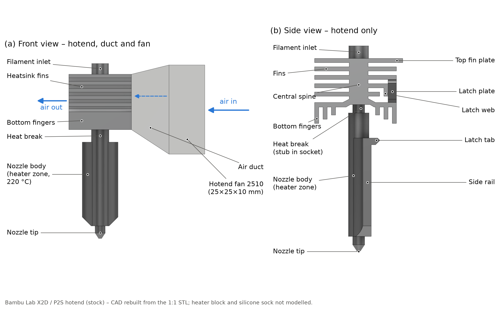

# 3D Printer Hotend Cooling Simulation (CFD)

CAD and conjugate-heat-transfer CFD of the Bambu Lab X2D / P2S hotend cooled by a 2510 fan through its duct, with two redesigned heatsinks. Course project 2103306, Chulalongkorn University.

## Results (45 °C ambient, nozzle body 220 °C, Pelonis C2510X05 fan curve)

| Case | Heat-break inlet (°C) | Heatsink max (°C) |
|---|---|---|
| Stock | 57.69 | 57.75 |
| Design 1 | 50.81 | 50.02 |
| Design 2 | 49.96 | 49.21 |

Design 2 mesh study (278k / 441k / 783k cells): oscillatory convergence, uncertainty about ±0.8 °C, so Design 2 is a borderline pass of the ≤ 50 °C heatsink criterion. Full write-up: `Hotend_Cooling_Report.pdf` (Thai).

## Layout

- `x2d_hotend_clean.py`, `x2d_hotend_fan_assembly.py` – Fusion 360 API scripts: clean parametric hotend, fan and duct assembly (`*.step`, `*.f3d` exports).
- `X2D_Nozzle_*` – source STL of the hotend (original 300 % and scaled 1:1).
- `fan_curve_2510.csv` – fan pressure–flow curve.
- `cfd/` – CFD domain scripts (`cfd_geometry_*.py`), Fluent Watertight meshing (`mesh_wtm.py`), case setup and solve via PyFluent (`setup_case.py`, `run_case.py`, `step*.py`), mesh study (`meshstudy.ps1`, `gci.py`), results in `cfd/results/`.
- `diagram/` – labelled component diagram.

Fluent mesh, case and data files (`*.h5`) are not included; rebuild them with `cfd/mesh_wtm.py` and `cfd/setup_case.py` (Ansys Fluent 2026 R1 + `ansys-fluent-core`).
