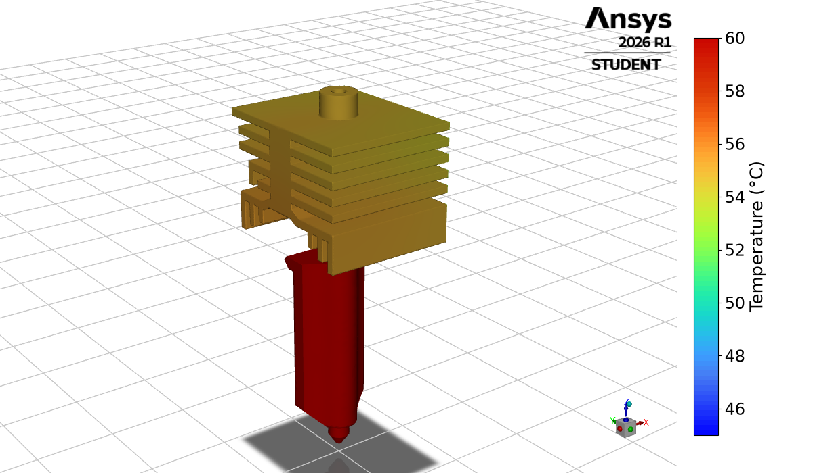
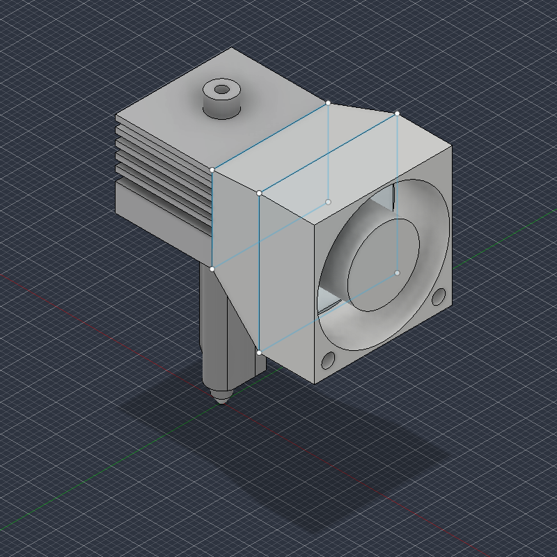
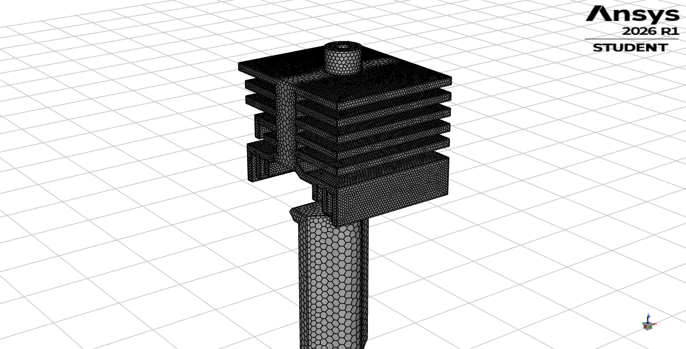
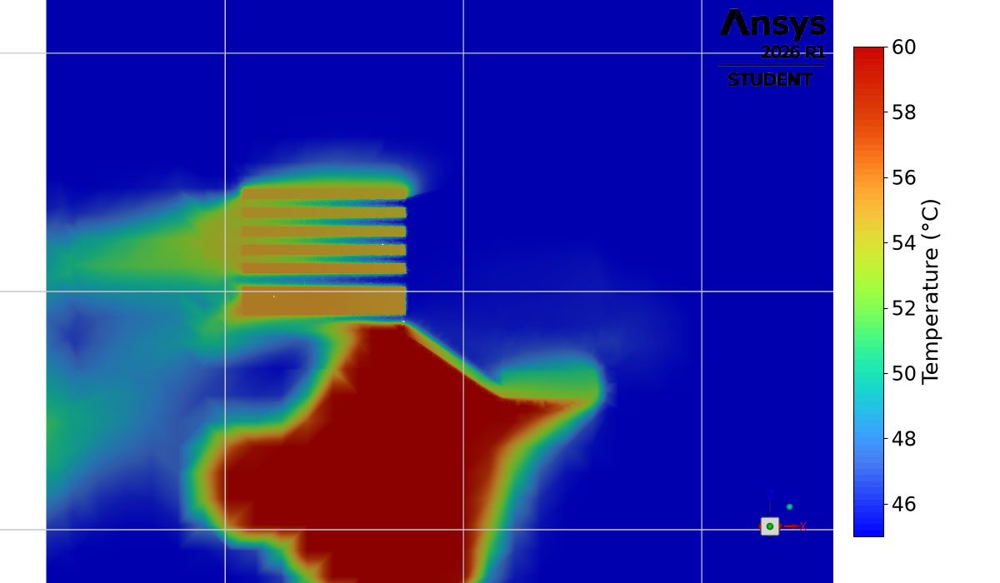
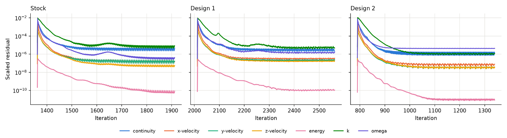

# 3D Printer Hotend Cooling Simulation (CFD)

**Can a better heatsink keep a 3D printer's hotend cool enough on a hot day?**

This project rebuilds the hotend of a Bambu Lab X2D / P2S 3D printer in CAD, simulates how heat and air move through it with Ansys Fluent, and tests two improved designs. It was a course project for *Computer-Aided Mechanical Engineering Design (2103306)*, Chulalongkorn University.

## In one minute

- **The problem:** The hotend melts plastic at the nozzle (220 °C for PLA), but the part above it must stay cool. If heat creeps up, the plastic softens too early and jams the printer.
- **The target:** On a 45 °C day inside the printer, keep the top of the heat break and the whole heatsink **at or below 50 °C**.
- **Stock hotend:** about **57.7 °C**, so it **fails** the target.
- **Design 1** (heat break made of titanium instead of stainless steel): **50.8 °C**, an improvement of about 7 °C, but still just over the target.
- **Design 2** (titanium heat break plus a new heatsink with more, thinner fins): **49.96 °C**, a **borderline pass**. The margin is smaller than the simulation's uncertainty (about ±0.8 °C).
- **Main lesson:** Most of the heat resistance sits in the thin heat break tube, not in the fins. A better heat break material helped about 9× more than better fins.

## Results

| Design | What changed | Heat break inlet (°C) | Heatsink max (°C) | Heat into heatsink (W) | Pass ≤ 50 °C? |
|---|---|:---:|:---:|:---:|:---:|
| Stock | – | 57.69 | 57.75 | 2.88 | ✗ |
| Design 1 | Titanium heat break | 50.81 | 50.02 | 1.06 | ✗ (just over) |
| Design 2 | Titanium heat break + new fins | **49.96** | **49.21** | 1.07 | ✓ (borderline) |

All three cases use a 45 °C ambient, a 220 °C nozzle and the same fan.

*Temperature on the parts, from left: Stock, Design 1, Design 2. The colour scale is 45–60 °C; the nozzle (220 °C) is off the scale, so it shows dark red. Cooler colours mean the design is working.*

## Background: what's inside a hotend

| Part | What it does |
|---|---|
| **Nozzle body** | Heated block that melts the plastic (held at 220 °C in the simulation). |
| **Heat break** | Thin tube between the hot and cold parts. It is meant to *block* heat. |
| **Heatsink** | Aluminium block with fins. It pulls heat out of the top of the heat break. |
| **Fan (2510)** | 25 × 25 × 10 mm, 5 V fan that blows air through the fins. |
| **Air duct** | Guides the fan's air through the gaps between the fins. |

PLA starts to soften at about 55–60 °C. That is why the target is 50 °C, which leaves a margin.

## How it was done

### 1. Build the 3D model
- Bambu Lab does not publish CAD files for this hotend. A public X2D hotend STL was scaled to 1:1 and redrawn as clean parametric CAD in **Fusion 360**, using Python API scripts. The volume matches the STL within 1.2 %.
- The fan and duct were modelled from the fan's datasheet and from measurements of the real print head.

### 2. Simplify it for simulation
Small details make the mesh much heavier without changing the result, so these were left out:
- The heater, the silicone sock, the screws, the wires and the filament hole.
- The fan blades, replaced by a "fan boundary" that adds pressure to the air.

### 3. Set up the simulation (Ansys Fluent, conjugate heat transfer)
"Conjugate heat transfer" means heat flowing through the solid parts and through the air is solved together.

- **Air box:** 90 × 60 × 90 mm around the parts. All six walls are open to air at 45 °C.
- **Heat source:** the nozzle body is held at a fixed 220 °C.
- **Fan:** pressure–flow curve of a Pelonis C2510X05. This is an assumption, because Bambu Lab does not publish its fan curve. The curve was scaled to the real fan's 15,500 rpm and 2.96 CFM.
- **Materials:**
  - Aluminium 6061 heatsink (k = 167 W/m·K).
  - Stainless-steel heat break (k = 16.3 W/m·K), or Ti-6Al-4V titanium (k = 6.7 W/m·K) in the new designs.
  - ABS fan and duct.
- **Physics:**
  - Steady state.
  - k-ω SST turbulence model.
  - Gravity on, so warm air rises.
- **Mesh:** about 400,000–440,000 cells (poly-hexcore), within the Ansys Student limit.

*Left: the fan curve used. The fan ends up running at about 2.4 m³/h, roughly half its free-air flow, because the fins resist the air. Right: the surface mesh.*

## What we learned from the stock hotend

*A slice through the fins. Left: air temperature. Right: air speed, about 5–7 m/s between the fins.*

- The heatsink is fairly even in temperature (about 55 °C on average) and sheds **2.9 W** to the air.
- Thermal resistance can be thought of as "how hard it is for heat to get through". The heat break's resistance is about **56 K/W**. The heatsink-to-air resistance is only about **4.4 K/W**.
- So the heat break controls about 93 % of the total resistance. **Bigger fins can only fix the small part.** Letting less heat into the heatsink in the first place fixes the big part.

## The two improved designs

**Design 1: titanium heat break.** Same shape as stock, but the heat break is Ti-6Al-4V titanium. It conducts heat about 2.4× worse than stainless steel. The heat reaching the heatsink drops from 2.88 W to 1.06 W.

**Design 2: titanium heat break plus a new heatsink.** It fits the same 17.5 × 21 × 18.5 mm space and uses the same fan.
- 6 fins, each 0.7 mm thick (stock: 5 fins of 1 mm). The gaps between fins stay about 1 mm, so the fan isn't choked.
- 5 bottom fingers per side (stock: 3).
- Fin area grows by **29 %** (4,634 → 5,980 mm²) with almost the same amount of aluminium.

*Left: the Design 2 heatsink. Right: air speed through its fins.*

## How much can we trust the numbers?

| Check | Result |
|---|---|
| Solver convergence | Residuals dropped about 4 orders of magnitude. Temperatures changed by less than 0.0001 °C over the last 50 iterations. |
| Mass and energy balance | Errors below 0.01 %. Air in equals air out, and heat in equals heat out. |
| Mesh study (Design 2: 278k / 441k / 783k cells) | 50.09 / 49.96 / 50.73 °C. The results bounce around rather than settling steadily, so the uncertainty is about **±0.8 °C**. |
| Turbulence model (SST vs laminar) | A difference of only 0.17 °C. |

Design 2 is only 0.04 °C under the limit, and the finest mesh puts it slightly over (50.7 °C). So the honest conclusion is **"borderline pass"**, not a confident pass.

## Limitations

- **Fan curve:** the curve is borrowed from a similar Pelonis fan, not measured on the real Bambu Lab fan.
- **Stock heat break material:** the stock heat break is assumed to be stainless steel. If the real one is already titanium or bimetal, Design 1's gain won't apply to the real product.
- **Heater:** the heater is not modelled. The whole nozzle body is simply fixed at 220 °C.
- **Physics left out:** the model is steady state only, with no thermal radiation and no contact resistance between parts.
- **Fixed 45 °C ambient:** at 25 °C, every temperature would be about 20 °C lower.
- **Next step for more margin:** cut the heat flowing through the heat break further, for example with a thinner wall or a longer neck, rather than adding more fins.

## Repository layout

| Path | Contents |
|---|---|
| `x2d_hotend_clean.py`, `x2d_hotend_fan_assembly.py` | Fusion 360 API scripts that build the clean hotend and the fan + duct assembly |
| `*.step`, `*.f3d` | CAD exports |
| `X2D_Nozzle_*` | Source STL (original 300 % scale and 1:1) |
| `fan_curve_2510.csv` | Fan pressure–flow table |
| `cfd/` | Simulation domain, meshing (`mesh_wtm.py`), setup and solve via PyFluent (`setup_case.py`, `run_case.py`), mesh study (`meshstudy.ps1`, `gci.py`) |
| `cfd/results/` | Result numbers (JSON) and Fluent images |
| `diagram/`, `images/` | Diagram and figures used in this README |
| `Hotend_Cooling_Report.pdf` / `.docx` | Full course report (in Thai) |

**To reproduce:** you need Fusion 360, Ansys Fluent 2026 R1 (Student is enough) and Python with `ansys-fluent-core`.
1. Build the CFD geometry with `cfd/cfd_geometry_fusion.py` (stock) or `cfd/cfd_geometry_d2.py` (Design 2).
2. Mesh it with `cfd/mesh_wtm.py`.
3. Run `cfd/setup_case.py`.
4. Run `cfd/run_case.py`.

The Fluent mesh, case and data files (`*.h5`, about 1.7 GB) are not included.

## References

1. Bambu Lab Wiki, *Hotend Replacement Guide for the P2S* and *Hotend Heating Assembly and Cooling Fan Replacement Guide for the P2S*.
2. 3DJake, *Bambu Lab Cooling Fan for Hotend, P2S (FAF021)*, technical specifications.
3. Pelonis Technologies, *2510-5 DC Fans (C2510X05BPLBx-5)* datasheet.
4. F. P. Incropera et al., *Fundamentals of Heat and Mass Transfer*, 7th ed., Wiley, 2011.
5. F. R. Menter, "Two-equation eddy-viscosity turbulence models for engineering applications," *AIAA Journal* 32(8), 1994.
6. I. B. Celik et al., "Procedure for estimation and reporting of uncertainty due to discretization in CFD applications," *J. Fluids Eng.* 130(7), 2008.
7. ANSYS, Inc., *Ansys Fluent User's Guide*, Release 2026 R1.
